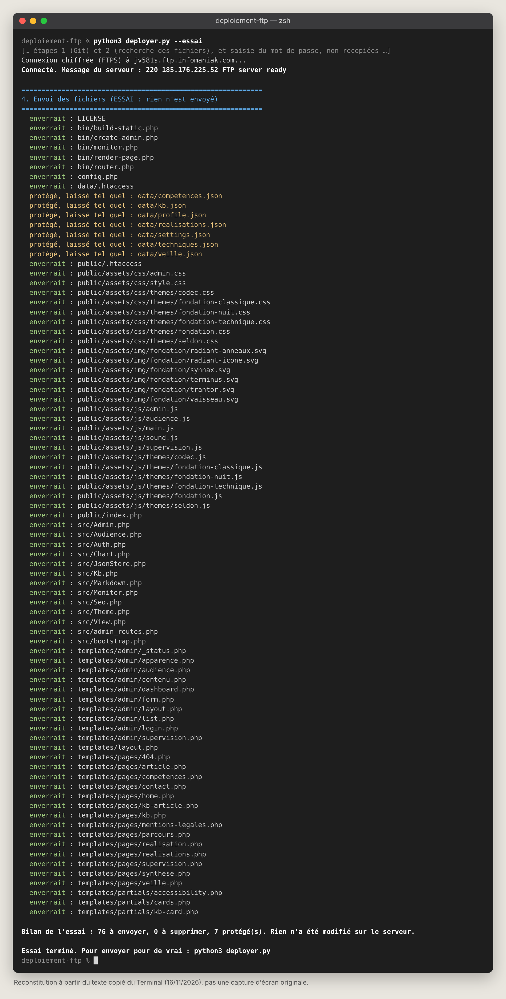

# Guide pas à pas : déployer le portfolio de Git vers FTP

Ce guide explique tout depuis le début, pour refaire l'exercice seul. Il suppose seulement un Mac, GitHub Desktop installé et le compte GitHub `n7rpvygk44-gif`.

**Durée :** 20 minutes la première fois, 1 minute ensuite.

---

## 0. Comprendre ce qu'on fait (2 minutes de lecture)

L'exercice demande un script Python qui :

1. **récupère** la dernière version du portfolio depuis Git ;
2. **se connecte** au serveur FTP ;
3. **envoie** les fichiers sur le serveur.

Le vocabulaire utile :

| Mot | Ce que ça veut dire ici |
|---|---|
| **Git** | Logiciel qui garde l'historique de toutes les versions des fichiers du site. |
| **Dépôt** (repository) | Un dossier suivi par Git. Il existe en deux exemplaires : un sur GitHub (en ligne), un sur le Mac (copie locale). |
| **Commit** | Une version enregistrée du dépôt, avec un identifiant comme `4ffbf13`. |
| **Branche** | Une ligne de versions. `main` est la version officielle ; les autres branches servent à essayer des changements. |
| **Clone / Pull** | *Clone* : télécharger le dépôt la première fois. *Pull* : récupérer les nouveautés ensuite. |
| **FTP** | Protocole qui sert à déposer des fichiers sur un serveur web. |
| **FTPS** | FTP chiffré par TLS : le mot de passe et les fichiers ne circulent pas en clair. Le script l'utilise. |
| **Script** | Un programme qu'on lance dans le Terminal pour automatiser des actions qu'on ferait à la main (ici, à la place de FileZilla). |

Le trajet des fichiers :

```
GitHub (portfolio-dashboard, branche main)
        │  git clone / git pull          ← étape 1 du script
        ▼
Mac : ~/Documents/portfolio-dashboard
        │  git diff : quoi de neuf ?     ← étape 2 (partie facultative)
        ▼
deployer.py ──FTPS──► Infomaniak : /portfolio   ← étapes 3 et 4
```

Il y a donc **deux dépôts** à ne pas confondre :

- `portfolio-dashboard` : le **site** (ce qu'on envoie) ;
- `deploiement-ftp` : le **script** (l'outil qui envoie).

---

## 1. Récupérer le script sur le Mac (une seule fois)

1. Ouvre **GitHub Desktop**.
2. Menu **File › Clone Repository…**
3. Onglet **GitHub.com**, choisis `n7rpvygk44-gif/deploiement-ftp`.
4. **Local Path** : `/Users/<ton nom>/Documents/deploiement-ftp`.
5. Clique sur **Clone**.

Tu as maintenant le dossier `Documents/deploiement-ftp` avec `deployer.py`, `config.exemple.ini`, `README.md` et ce guide.

---

## 2. Mettre la copie du portfolio sur `main` (à chaque fois)

Le script envoie la branche `main`, la version officielle. Si ta copie locale est sur une autre branche, il s'arrête (c'est l'erreur que tu as eue avec `claude/project-thread-d7tlgx`).

1. Dans GitHub Desktop, en haut à gauche, **Current Repository** : choisis `portfolio-dashboard`.
2. **Current Branch** : choisis `main`.
3. Clique sur **Fetch origin**. Si le bouton devient **Pull origin**, clique dessus. S'il reste sur *Fetch*, ta copie est déjà à jour.
4. Vérifie que la colonne **Changes** à gauche est vide (0 changed files). Sinon, fais un commit ou clic droit › *Discard changes*.

> Le script fait lui-même le `git pull`, mais il refuse de travailler sur une mauvaise branche ou avec des modifications non enregistrées, pour ne jamais envoyer un mélange.

---

## 3. Ouvrir le Terminal au bon endroit

Le Terminal est l'application où l'on tape des commandes (Launchpad › Autres › Terminal, ou Cmd + Espace puis « Terminal »).

À l'ouverture, tu es dans ton **dossier personnel**, noté `~` (par exemple `/Users/olivier`). Le script n'y est pas : c'est pour ça que `python3 deployer.py` affichait `can't open file` la première fois.

Les trois commandes de base :

```bash
pwd                          # « où suis-je ? » : affiche le dossier actuel
ls                           # liste les fichiers du dossier actuel
cd ~/Documents/deploiement-ftp   # « change directory » : va dans le dossier du script
```

Après le `cd`, l'invite affiche `deploiement-ftp %` et `ls` doit montrer `deployer.py`. Si ce n'est pas le cas, ne va pas plus loin : vérifie le chemin du clone (étape 1).

> Astuce : tape `cd ` (avec l'espace), puis glisse le dossier depuis le Finder dans la fenêtre du Terminal ; le chemin s'écrit tout seul. Appuie ensuite sur Entrée.

---

## 4. Créer la configuration (une seule fois)

```bash
cp config.exemple.ini config.ini   # copie le modèle sous le nom config.ini
open -e config.ini                 # l'ouvre dans TextEdit pour le relire
```

Le modèle est déjà rempli pour Infomaniak. Vérifie seulement :

```ini
[git]
depot = https://github.com/n7rpvygk44-gif/portfolio-dashboard.git
branche = main
dossier_local = ~/Documents/portfolio-dashboard

[ftp]
hote = jv581s.ftp.infomaniak.com
utilisateur = jv581s_olivier_
mot_de_passe =              ← laisse vide : il sera demandé
dossier_distant = /portfolio
chiffrement = oui
```

Pourquoi deux fichiers ? `config.exemple.ini` est publié sur GitHub (il ne contient aucun secret). `config.ini` est **ta** configuration : le fichier `.gitignore` empêche Git de le publier, donc même si tu y mets un jour ton mot de passe, il ne partira jamais sur GitHub.

---

## 5. Faire un essai (recommandé à chaque fois)

```bash
python3 deployer.py --essai
```

- `python3` : lance l'interpréteur Python ;
- `deployer.py` : le script à exécuter ;
- `--essai` : une **option** qui dit au script de tout préparer, de se connecter, mais de ne **rien envoyer**.

Quand il demande `Mot de passe FTP de jv581s_olivier_ :`, tape le mot de passe FTP d'Infomaniak puis Entrée. **Rien ne s'affiche pendant la frappe, c'est normal** (c'est la même chose que `sudo`).

Voici le résultat de ton essai du 16/11/2026 :



*Image reconstituée à partir du texte copié du Terminal. Pour une vraie capture, utilise Cmd + Maj + 4, puis Espace, puis clique sur la fenêtre du Terminal ; l'image arrive sur le Bureau.*

### Lire le résultat ligne par ligne

| Ce qui s'affiche | Ce que ça veut dire |
|---|---|
| `1. Récupération du portfolio depuis Git` puis `Version obtenue : xxxxxxx « … »` | Le script a fait `git pull` et indique le commit qu'il va déployer. |
| `2. Recherche des fichiers à envoyer` puis `Déploiement complet` | Premier déploiement : il n'y a pas encore de « dernier commit envoyé », donc tous les fichiers sont pris. Les fois suivantes, tu verras seulement les fichiers modifiés, avec une lettre : **A** ajouté, **M** modifié, **D** supprimé. |
| `Connexion chiffrée (FTPS) à jv581s.ftp.infomaniak.com...` | Le script ouvre la connexion et active le chiffrement TLS. |
| `Connecté. Message du serveur : 220 … FTP server ready` | Le serveur a accepté l'identifiant et le mot de passe. **220** est le code FTP « prêt ». |
| `enverrait : public/index.php` | En mode essai : ce fichier serait envoyé. |
| `protégé, laissé tel quel : data/kb.json` | Ce fichier existe déjà sur le serveur et contient le contenu modifié depuis `/admin` : le script ne l'écrase pas. |
| `Bilan de l'essai : 76 à envoyer, 0 à supprimer, 7 protégé(s)` | Résumé. 76 fichiers de code, 7 fichiers de données protégés. `README.md`, `docs/` et `.gitignore` sont volontairement exclus. |

---

## 6. Envoyer pour de vrai

Même commande, **sans** `--essai` :

```bash
python3 deployer.py
```

Cette fois, chaque ligne devient `envoi : public/index.php (1234 octets)... ok`, avec parfois `dossier créé : /portfolio/src` quand un dossier manquait sur le serveur. À la fin :

```
Bilan : 76 envoyé(s), 0 supprimé(s), 7 protégé(s).
Commit xxxxxxx noté dans etat-deploiement.json.
Déploiement terminé.
```

Le fichier `etat-deploiement.json` vient d'être créé dans le dossier du script. Il mémorise le commit envoyé : c'est grâce à lui que la fois suivante, seuls les changements partiront (partie facultative de l'exercice).

---

## 7. Vérifier sur Infomaniak

1. Ouvre FileZilla (ou le gestionnaire de fichiers du Manager Infomaniak) : le dossier `/portfolio` doit contenir `bin`, `config.php`, `data`, `public`, `src`, `templates`.
2. Le site doit afficher le contenu de **`/portfolio/public`**, pas `/portfolio` : seuls les fichiers de `public/` doivent être visibles depuis Internet ; `src/`, `data/` et `config.php` doivent rester cachés. Dans le Manager Infomaniak, ouvre les réglages de ton site et règle son **dossier racine** sur `/portfolio/public` (le nom exact du menu peut varier selon l'interface).
3. Ouvre l'adresse du site de test dans le navigateur.

> Rappel : Infomaniak n'est qu'un essai. Le site officiel reste https://olivierpizelle.alwaysdata.net, que ce script ne touche pas.

---

## 8. Les fois suivantes (le circuit complet)

1. Une modification du site est fusionnée sur `main` sur GitHub.
2. Terminal :
   ```bash
   cd ~/Documents/deploiement-ftp
   python3 deployer.py --essai     # je regarde ce qui va partir
   python3 deployer.py             # j'envoie
   ```
3. Si rien n'a changé : `Le serveur est déjà à jour. Fin.`

Pour tout renvoyer (par exemple après avoir vidé le serveur) : `python3 deployer.py --tout`.

Pour voir tout le dialogue avec le serveur (dépannage) : `python3 deployer.py --detail`. Les lignes `*cmd*` sont les commandes envoyées par le script (`STOR`, `MKD`…), les lignes `*resp*` les réponses du serveur avec leur code (`226` = fichier bien reçu). Le mot de passe y est masqué.

---

## 9. Erreurs fréquentes

| Message | Cause | Solution |
|---|---|---|
| `can't open file '/Users/…/deployer.py': No such file or directory` | Le Terminal n'est pas dans le dossier du script (tu étais dans `~`). | `cd ~/Documents/deploiement-ftp`, puis relance. |
| `le dépôt local est sur la branche « claude/… » au lieu de « main »` | GitHub Desktop était resté sur une branche de travail. | GitHub Desktop › Current Branch › `main`, puis relance. |
| `le dépôt local contient des modifications non enregistrées` | Des fichiers du portfolio ont été modifiés sans commit. | Fais un commit ou *Discard changes* dans GitHub Desktop. |
| `le fichier de configuration … config.ini est introuvable` | L'étape 4 n'a pas été faite. | `cp config.exemple.ini config.ini` |
| `connexion refusée par le serveur : 530 …` | Identifiant ou mot de passe faux. | Vérifie le compte FTP dans le Manager Infomaniak. |
| `impossible de joindre … : timed out` | Problème réseau. | Vérifie la connexion internet et réessaie. |
| `ERREUR : l'envoi a été interrompu : timed out` (l'essai marchait) | L'essai n'utilise que la **connexion de commande**. L'envoi réel ouvre en plus une **connexion de données** par fichier, et c'est elle qui restait bloquée : le serveur FTPS d'Infomaniak n'accepte pas la façon dont Python chiffre cette 2ᵉ connexion par défaut (TLS 1.3, fermeture TLS). Corrigé le 16/11/2026 dans le script (TLS 1.2, réutilisation de session, fermeture directe). | Récupère la dernière version du script (GitHub Desktop › `deploiement-ftp` › Fetch puis Pull) et relance. Si ça bloque encore, lance `python3 deployer.py --detail` : le dialogue FTP complet s'affiche, la dernière ligne montre où ça coince. |
| `certificate verify failed` | Python ne connaît pas encore les certificats de confiance. | Finder › Applications › dossier Python 3.x › double-clic sur *Install Certificates.command*. |
| `command not found: python3` ou `git` | Outils de développement absents. | `xcode-select --install`, puis accepte. |

---

## 10. Ce que fait chaque partie du script

Le fichier `deployer.py` est découpé en fonctions, une par étape. Chacune est commentée dans le code.

| Fonction | Rôle |
|---|---|
| `lire_configuration()` | Lit `config.ini`. Le mot de passe vient de la variable `FTP_MOT_DE_PASSE`, de `config.ini` ou d'une saisie masquée (`getpass`). |
| `recuperer_depot()` | **Étape 1.** Lance `git clone` si le dossier n'existe pas, sinon vérifie la branche, l'absence de modifications, puis lance `git pull --ff-only`. |
| `lister_changements()` | **Étape 2.** Lit le dernier commit envoyé dans `etat-deploiement.json`, puis `git diff --name-status` pour lister les fichiers ajoutés, modifiés et supprimés. Première fois : `git ls-files` (tous les fichiers). Retire les fichiers exclus. |
| `se_connecter()` | **Étape 3.** Connexion FTPS avec `ftplib.FTP_TLS` : `AUTH TLS` (chiffre la connexion), `login`, `PROT P` (chiffre aussi les transferts), mode passif. |
| `envoyer()` | **Étape 4.** Pour chaque fichier : vérifie s'il est protégé, crée les dossiers manquants (`MKD`), envoie le contenu (`STOR`). Supprime les fichiers effacés dans Git (`DELE`). |
| `memoriser_deploiement()` | Note le commit envoyé, seulement si tout s'est bien passé. |
| `main()` | Lit les options (`--essai`, `--tout`) et enchaîne les étapes. |

---

## 11. Pour le dossier E5

Ce que je peux présenter :

- **Besoin :** mettre en ligne le portfolio sans copier les fichiers à la main avec FileZilla, et sans risque d'erreur.
- **Solution :** un script Python (bibliothèque standard uniquement) qui relie Git et un serveur FTPS, avec envoi incrémental des seuls fichiers modifiés.
- **Sécurité :** transfert chiffré FTPS, aucun mot de passe dans le code ni sur GitHub (`.gitignore`), données de production (`data/*.json`) protégées, mode essai avant tout envoi.
- **Preuves :** le dépôt https://github.com/n7rpvygk44-gif/deploiement-ftp, la capture de l'essai ci-dessus, et une capture du déploiement réel à ajouter.
